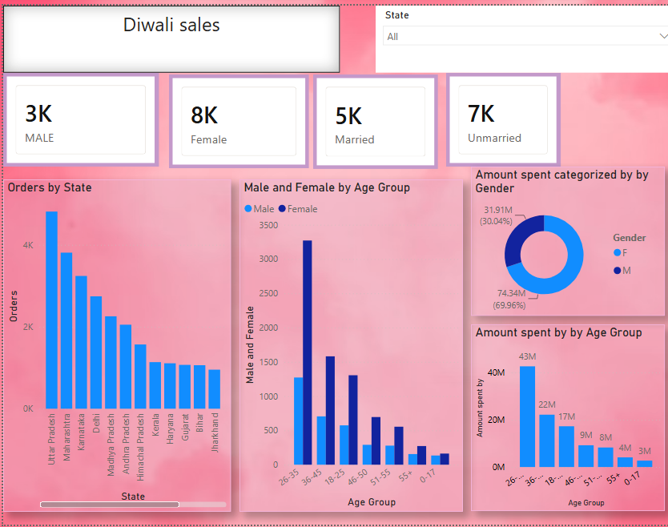
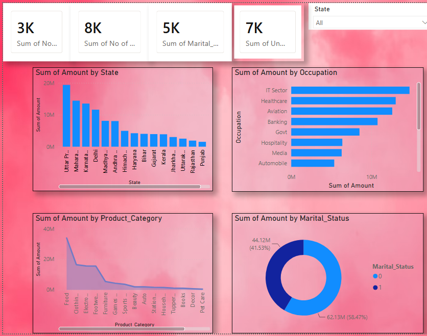

# 🪔 Diwali Sales Analysis Dashboard using Power BI

## 📌 Project Overview

This project focuses on analyzing Diwali sales data using **Microsoft Power BI** to understand customer purchasing behavior, sales performance, and business trends during the festive season.

The dashboard transforms raw sales data into meaningful visual insights that help businesses identify high-performing product categories, customer segments, and opportunities to improve sales strategies.

## 🎯 Objectives

- Analyze overall sales and order performance during Diwali.
- Identify top-performing product categories and products.
- Understand customer purchasing patterns by gender, age group, and occupation.
- Analyze sales across different states and customer segments.
- Provide actionable insights to support business decision-making.

## 🛠️ Tools & Technologies

- **Power BI Desktop** – Dashboard development and visualization
- **Microsoft Excel / CSV** – Dataset preparation and data storage
- **Power Query** – Data cleaning and transformation
- **DAX** – Calculated measures and KPIs

## 📊 Dashboard Preview

### Page 1: Sales Overview

This page provides a high-level overview of Diwali sales performance using KPI cards, charts, and interactive visualizations.

**Key insights displayed:**

- Total sales and order performance
- Sales distribution by product category
- Sales trends across customer segments
- Gender-wise purchasing analysis
- State-wise sales performance



### Page 2: Customer & Product Analysis

This page focuses on understanding customer demographics and identifying the products and customer segments that contribute most to sales.

**Key insights displayed:**

- Customer segmentation by age group
- Sales analysis by occupation
- Top-performing product categories
- Product purchasing patterns
- Customer preferences and buying behavior



> **Note:** Replace the image paths above with your actual dashboard screenshots. Create an `images` folder in your GitHub repository and upload the two preview images.

## 📈 Key Business Insights

The dashboard can help answer questions such as:

- Which product categories generate the highest sales?
- Which customer demographics contribute most to revenue?
- Which states have the strongest sales performance?
- How do purchasing patterns differ across gender and occupation?
- Which products or customer segments offer opportunities for targeted marketing?

_Actual findings should be added after analyzing the dataset and validating the Power BI visuals._

## 📂 Project Structure

```
Diwali-Sales-Dashboard/
│
├── 
│   ├── page1.png
│   └── page2.png
│
├── 
│   └── diwali_sales_data.csv
│
├── Diwali_Sales_Dashboard.pbix
│
└── README.md
```

## 🚀 How to Use

1. Clone or download this repository.
2. Install [Microsoft Power BI Desktop](<https://powerbi.microsoft.com/desktop/>).
3. Open `Diwali_Sales_Dashboard.pbix`.
4. If required, update the dataset source path.
5. Refresh the data to load the latest information.
6. Explore the dashboard using filters, slicers, and interactive charts.

## 💡 Business Value

This project demonstrates how business intelligence and data visualization can help retailers understand festive-season sales, discover customer preferences, and make data-driven decisions about marketing, inventory, and product planning.

## 🔮 Future Improvements

- Add year-over-year sales comparisons.
- Include profit and profit-margin analysis if the required data is available.
- Develop customer purchase segmentation.
- Add forecasting for future festive-season sales.
- Publish an interactive version using Power BI Service.

## 👨‍💻 Skills Demonstrated

- Data cleaning and transformation
- Exploratory data analysis
- Data modeling
- DAX calculations
- KPI development
- Interactive dashboard design
- Business insight generation

## ⭐ Conclusion

The Diwali Sales Analysis Dashboard showcases the use of Power BI to convert sales data into actionable business insights. It provides an interactive view of customer behavior, product performance, and sales distribution during the Diwali shopping season.

If you find this project useful, consider giving the repository a ⭐ on GitHub.
